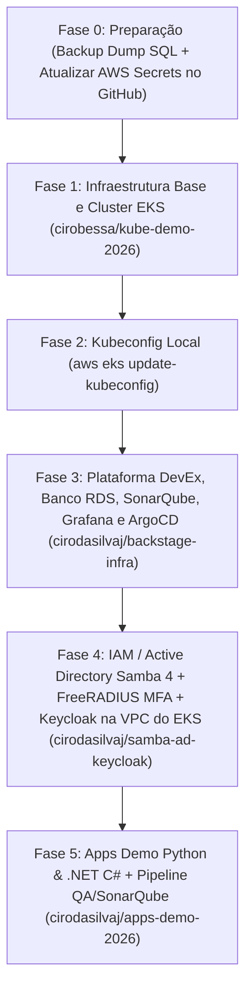

# Guia de Ordenação de Deploys do Zero (Nova Conta AWS 7 Horas)

Este documento descreve a **ordem exata de execução** para recriar toda a arquitetura do zero quando a conta de demonstração da AWS expirar, garantindo que todas as dependências de rede (VPC/Sub-redes), cluster EKS, banco RDS PostgreSQL, identidade (Samba 4 AD + FreeRADIUS MFA + Keycloak), qualidade/segurança (SonarQube), observabilidade (Prometheus + Grafana) e aplicações subam sem conflitos.

---

## Visão Geral da Ordem de Provisionamento



---

## Fase 0 — Antes da Conta Antiga Expirar (Opcional) e Atualização de Credenciais AWS

1. **(Se a conta anterior ainda estiver ativa)** Baixar o dump SQL atualizado do RDS PostgreSQL pelo endpoint do Backstage:
   ```bash
   curl -u admin:Backstage@2026 \
     -o /home/ciro/backstate-infra/db/schema.sql \
     http://<BACKSTAGE_ELB_HOSTNAME>/backstage-rds-dump.sql
   ```
   > Caso não baixe um novo dump, o arquivo versionado `db/schema.sql` e o `ConfigMap` `backstage-app-config` já contêm o schema completo e todas as entidades pré-cadastradas (incluindo a conexão com o cluster `kube-demo-eks`).

2. **Atualizar as credenciais da nova conta AWS** (`AWS_ACCESS_KEY_ID`, `AWS_SECRET_ACCESS_KEY`, `AWS_REGION=us-east-1`) localmente e nos Secrets dos repositórios GitHub:
   ```bash
   export AWS_ACCESS_KEY_ID="SEU_NOVO_ACCESS_KEY"
   export AWS_SECRET_ACCESS_KEY="SEU_NOVO_SECRET_KEY"
   export AWS_REGION="us-east-1"

   # 1. Atualizar no repositório do Cluster EKS (conta cirobessa)
   gh auth switch -u cirobessa
   gh secret set AWS_ACCESS_KEY_ID -b "$AWS_ACCESS_KEY_ID" -R cirobessa/kube-demo-2026
   gh secret set AWS_SECRET_ACCESS_KEY -b "$AWS_SECRET_ACCESS_KEY" -R cirobessa/kube-demo-2026
   gh secret set AWS_REGION -b "$AWS_REGION" -R cirobessa/kube-demo-2026

   # 2. Atualizar nos repositórios da Plataforma e IAM (conta cirodasilvaj)
   gh auth switch -u cirodasilvaj
   for repo in cirodasilvaj/backstage-infra cirodasilvaj/samba-ad-keycloak; do
     gh secret set AWS_ACCESS_KEY_ID -b "$AWS_ACCESS_KEY_ID" -R "$repo"
     gh secret set AWS_SECRET_ACCESS_KEY -b "$AWS_SECRET_ACCESS_KEY" -R "$repo"
     gh secret set AWS_REGION -b "$AWS_REGION" -R "$repo"
   done
   ```

---

## Fase 1 — Infraestrutura Base: VPC, Sub-redes, Cluster EKS e Prometheus (`cirobessa/kube-demo-2026`)

> **Por que é o 1º?** Cria a VPC (`10.0.0.0/16`), as sub-redes públicas e privadas em 2 AZs, NAT Gateway, o cluster EKS `kube-demo-eks` (v1.35), o Node Group EC2 e o servidor **Prometheus** no namespace `monitoring`. Todos os demais repositórios descobrem essa VPC e esse cluster dinamicamente via `data "aws_eks_cluster"`.

```bash
gh auth switch -u cirobessa
gh workflow run terraform.yml -R cirobessa/kube-demo-2026 -f action=apply
```
- **Tempo médio:** ~12 a 15 minutos.
- **Acompanhar execução:**
  ```bash
  gh run list -R cirobessa/kube-demo-2026 -L 1
  ```

---

## Fase 2 — Configurar o `kubectl` Local

Assim que a Fase 1 concluir, atualize o `kubeconfig` da sua máquina para apontar para o novo cluster EKS:

```bash
aws eks update-kubeconfig --name kube-demo-eks --region us-east-1
kubectl get nodes
```

---

## Fase 3 — Plataforma DevEx, Banco RDS, ArgoCD, SonarQube e Grafana (`cirodasilvaj/backstage-infra`)

> **Por que é o 2º deploy?** Conecta-se ao cluster `kube-demo-eks` recém-criado e provisiona em uma única execução:
> 1. **ArgoCD** (exposto via AWS LoadBalancer na porta `80`/`8080`).
> 2. **AWS RDS PostgreSQL 16 (`db.t4g.micro`)** na VPC do EKS (cria o banco `backstage_plugin_catalog` e o banco `sonarqube`).
> 3. **Backstage Developer Portal** (`k8s-manifests/backstage/`) com RBAC `ClusterRole/backstage-kubernetes-deployer` (permissão total de leitura e deploy no EKS), restauração automática do `db/schema.sql` e endpoints `/backstage-rds-dump.sql` e `/k8s-cluster-status.json`.
> 4. **SonarQube QA & Security** (`k8s-manifests/sonarqube/` + `terraform/modules/sonarqube/`) com plugins **OWASP Dependency-Check**, **SpotBugs/FindSecBugs**, **YAML/Kubernetes Analyzer**, **Python**, **C#** e **JaCoCo**, exposto via AWS LoadBalancer (`80`/`9000`).
> 5. **Grafana** (`k8s-manifests/grafana/` + `terraform/modules/grafana/`) pré-conectado ao datasource do **Prometheus** (`http://prometheus-server.monitoring.svc.cluster.local`) e exposto via AWS LoadBalancer (`80`/`3000`).
> 6. **Fluentd** para coleta de logs do cluster.
> 7. **Disparo encadeado do `samba-ad-keycloak`** na mesma VPC do EKS.

```bash
gh auth switch -u cirodasilvaj
gh workflow run terraform.yml -R cirodasilvaj/backstage-infra -f action=apply
```
- **Tempo médio:** ~6 a 8 minutos.
- **Ao concluir, todos os URLs e credenciais aparecem no step `Sync Backstage manifests and show outputs`:**
  - `argocd_external_url` + senha inicial do `admin`
  - `backstage_external_url` (`admin` / `Backstage@2026`)
  - `sonarqube_external_url` (`admin` / `Sonar@2026`)
  - `grafana_external_url` (`admin` / `Grafana@2026`)

---

## Fase 4 — Active Directory (Samba 4 Multi-DC), FreeRADIUS MFA e Keycloak (`cirodasilvaj/samba-ad-keycloak`)

> **Nota:** O workflow do `backstage-infra` (Fase 3) já executa automaticamente o Terraform do `samba-ad-keycloak` dentro da VPC do EKS! Caso queira executar ou atualizar isoladamente:

```bash
gh auth switch -u cirodasilvaj
gh workflow run deploy.yml -R cirodasilvaj/samba-ad-keycloak -f action=apply
```
- Provisiona na VPC do EKS (`kube-demo-eks`):
  - **Samba 4 AD DC 1 (`t3.micro`)** + **FreeRADIUS 3.0 + Google Authenticator TOTP MFA** na sub-rede privada AZ1.
  - **Samba 4 AD DC 2 (`t3.micro`)** em réplica DRS (`--dns-backend=NONE`) + **FreeRADIUS** na sub-rede privada AZ2.
  - **Keycloak 26 (`t3.micro`)** (IdP SAML 2.0 / OIDC federado ao Samba 4 LDAP e MFA RADIUS).
  - **AWS Route 53 Private Hosted Zone (`empresa.local`)** associada à VPC do EKS (`dc1.empresa.local`, `dc2.empresa.local`, `ad.empresa.local`, `radius.empresa.local`, `sso.empresa.local` e registros SRV Kerberos/LDAP).

---

## Fase 5 — Aplicações Web Demo (Python & .NET C#) e Pipeline CI/CD com SonarQube (`cirodasilvaj/apps-demo-2026`)

1. As aplicações **Python 3.12 (Flask)** e **.NET 8 (C# Minimal API)** já são sincronizadas automaticamente no namespace `apps-demo` pelo ArgoCD através do manifesto `k8s-manifests/backstage/argo-app-apps-demo.yaml`.
2. Para rodar a pipeline de **QA Unit Tests + SonarQube Security Scan + Build GHCR**:
   ```bash
   gh auth switch -u cirodasilvaj
   # Opcional: atualizar a URL do novo LoadBalancer do SonarQube no secret do repositório
   gh secret set SONAR_HOST_URL -b "http://<NOVO_SONARQUBE_ELB>:9000" -R cirodasilvaj/apps-demo-2026
   gh workflow run build.yml -R cirodasilvaj/apps-demo-2026
   ```

---

## Resumo de Credenciais Padrão da Plataforma

| Serviço | Usuário | Senha Padrão | Porta / Caminho |
| :--- | :--- | :--- | :--- |
| **Backstage Portal** | `admin` | `Backstage@2026` | `:80` ou `:7007` |
| **SonarQube QA & Security** | `admin` | `Sonar@2026` (ou `admin` nos primeiros 2 min de boot) | `:80` ou `:9000` |
| **Grafana Observability** | `admin` | `Grafana@2026` | `:80` ou `:3000` |
| **ArgoCD GitOps** | `admin` | Gerada no secret `argocd-initial-admin-secret` (exibida no output do pipeline) | `:80` ou `:8080` |
| **AWS RDS PostgreSQL** | `backstage` | `BackstageRds2026!` | `:5432` (interno na VPC) |
| **Keycloak IAM** | `admin` | `KeycloakAdmin2026!` | `https://sso.empresa.local` (interno na VPC) |
| **Samba 4 AD (`EMPRESA.LOCAL`)** | `Administrator` | `SambaAdm2026!Strong` | LDAP `:389` / LDAPS `:636` / Kerberos `:88` |
