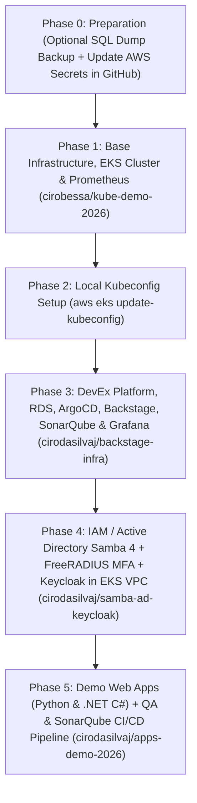

# Zero-to-Production Deployment Order Runbook (New 7-Hour AWS Account)

This document describes the **exact execution order** required to recreate the entire architecture from scratch when the 7-hour AWS sandbox account expires. Following this sequence guarantees that all network dependencies (VPC/Subnets), the EKS cluster, the RDS PostgreSQL database, the identity stack (Samba 4 AD + FreeRADIUS MFA + Keycloak), code quality/security (SonarQube), observability (Prometheus + Grafana), and sample applications come up cleanly without conflicts.

---

## Provisioning Order Overview



---

## Phase 0 — Before the Old Account Expires (Optional) & Updating AWS Credentials

1. **(Optional — If the previous AWS account is still active)** Download the latest live PostgreSQL SQL dump from the Backstage endpoint:
   ```bash
   curl -u admin:Backstage@2026 \
     -o /home/ciro/backstate-infra/db/schema.sql \
     http://<BACKSTAGE_ELB_HOSTNAME>/backstage-rds-dump.sql
   ```
   > Even if you do not download a new dump, the version-controlled `db/schema.sql` file and the `backstage-app-config` `ConfigMap` already include the complete schema and pre-seeded entities (including the `kube-demo-eks` cluster connection).

2. **Update the new AWS account credentials** (`AWS_ACCESS_KEY_ID`, `AWS_SECRET_ACCESS_KEY`, `AWS_REGION=us-east-1`) locally and in the GitHub Actions Secrets of the repositories:
   ```bash
   export AWS_ACCESS_KEY_ID="YOUR_NEW_ACCESS_KEY_ID"
   export AWS_SECRET_ACCESS_KEY="YOUR_NEW_SECRET_ACCESS_KEY"
   export AWS_REGION="us-east-1"

   # 1. Update secrets in the EKS Cluster repository (cirobessa account)
   gh auth switch -u cirobessa
   gh secret set AWS_ACCESS_KEY_ID -b "$AWS_ACCESS_KEY_ID" -R cirobessa/kube-demo-2026
   gh secret set AWS_SECRET_ACCESS_KEY -b "$AWS_SECRET_ACCESS_KEY" -R cirobessa/kube-demo-2026
   gh secret set AWS_REGION -b "$AWS_REGION" -R cirobessa/kube-demo-2026

   # 2. Update secrets in the Platform and IAM repositories (cirodasilvaj account)
   gh auth switch -u cirodasilvaj
   for repo in cirodasilvaj/backstage-infra cirodasilvaj/samba-ad-keycloak; do
     gh secret set AWS_ACCESS_KEY_ID -b "$AWS_ACCESS_KEY_ID" -R "$repo"
     gh secret set AWS_SECRET_ACCESS_KEY -b "$AWS_SECRET_ACCESS_KEY" -R "$repo"
     gh secret set AWS_REGION -b "$AWS_REGION" -R "$repo"
   done
   ```

---

## Phase 1 — Base Infrastructure: VPC, Subnets, EKS Cluster, and Prometheus (`cirobessa/kube-demo-2026`)

> **Why is this 1st?** It creates the VPC (`10.0.0.0/16`), public and private subnets across 2 Availability Zones, NAT Gateway, the `kube-demo-eks` (v1.35) cluster, the EC2 Managed Node Group, and the **Prometheus** server in the `monitoring` namespace. All other repositories dynamically discover this VPC and cluster via `data "aws_eks_cluster"`.

```bash
gh auth switch -u cirobessa
gh workflow run eks.yml -R cirobessa/kube-demo-2026 -f action=apply
```
- **Average duration:** ~12 to 15 minutes.
- **Monitor progress:**
  ```bash
  gh run list -R cirobessa/kube-demo-2026 -L 1
  ```

---

## Phase 2 — Configure Local `kubectl`

Once Phase 1 finishes, update your local `kubeconfig` to point to the newly created EKS cluster:

```bash
aws eks update-kubeconfig --name kube-demo-eks --region us-east-1
kubectl get nodes
```

---

## Phase 3 — DevEx Platform, RDS Database, ArgoCD, SonarQube, and Grafana (`cirodasilvaj/backstage-infra`)

> **Why is this 2nd?** It connects to the newly created `kube-demo-eks` cluster and provisions in a single automated run:
> 1. **ArgoCD** (exposed via AWS LoadBalancer on ports `80`/`8080`).
> 2. **AWS RDS PostgreSQL 16 (`db.t4g.micro`)** inside the EKS VPC (creates both the `backstage_plugin_catalog` and `sonarqube` databases).
> 3. **Backstage Developer Portal** (`k8s-manifests/backstage/`) with `ClusterRole/backstage-kubernetes-deployer` RBAC (full read and deploy permissions on EKS), automatic restoration of `db/schema.sql`, and `/backstage-rds-dump.sql` + `/k8s-cluster-status.json` endpoints.
> 4. **SonarQube QA & Security** (`k8s-manifests/sonarqube/` + `terraform/modules/sonarqube/`) with **OWASP Dependency-Check**, **SpotBugs/FindSecBugs**, **YAML/Kubernetes Analyzer**, **Python**, **C#**, and **JaCoCo** plugins, exposed via AWS LoadBalancer (`80`/`9000`).
> 5. **Grafana** (`k8s-manifests/grafana/` + `terraform/modules/grafana/`) pre-wired to the **Prometheus** datasource (`http://prometheus-server.monitoring.svc.cluster.local`) and exposed via AWS LoadBalancer (`80`/`3000`).
> 6. **Fluentd** for cluster-wide container log collection.
> 7. **Automatic Route 53 DNS delegation** (`terraform/dns.tf`), discovering the lab's public hosted zone (`*realhandsonlabs.net`) and mapping friendly CNAMEs (`backstage.*`, `grafana.*`, `argocd.*`, `sonarqube.*`) to their respective LoadBalancers on port 80.
> 8. **Chained deployment of `samba-ad-keycloak`** inside the same EKS VPC.

```bash
gh auth switch -u cirodasilvaj
gh workflow run terraform.yml -R cirodasilvaj/backstage-infra -f action=apply
```
- **Average duration:** ~6 to 8 minutes.
- **Upon completion, friendly Route 53 URLs, ELB endpoints, and credentials are displayed in the GitHub Step Summary:**
  - `route53_backstage_url`: `http://backstage.<lab-id>.realhandsonlabs.net` (`admin` / `Backstage@2026`)
  - `route53_grafana_url`: `http://grafana.<lab-id>.realhandsonlabs.net` (`admin` / `Grafana@2026`)
  - `route53_argocd_url`: `http://argocd.<lab-id>.realhandsonlabs.net` (`admin` / initial admin secret)
  - `route53_sonarqube_url`: `http://sonarqube.<lab-id>.realhandsonlabs.net` (`admin` / `Sonar@2026`)
  *(Fallback ELB URLs are also preserved: `argocd_external_url`, `backstage_external_url`, `sonarqube_external_url`, `grafana_external_url`)*
- **Manual CLI sync tool (optional):** `./scripts/sync-dns-route53.sh` can be executed at any time to re-sync or verify Route 53 records from local terminal.

---

## Phase 4 — Active Directory (Samba 4 Multi-DC), FreeRADIUS MFA, and Keycloak (`cirodasilvaj/samba-ad-keycloak`)

> **Note:** The `backstage-infra` workflow (Phase 3) automatically executes the `samba-ad-keycloak` Terraform configuration inside the EKS VPC! If you wish to run or update it independently:

```bash
gh auth switch -u cirodasilvaj
gh workflow run deploy.yml -R cirodasilvaj/samba-ad-keycloak -f action=apply
```
- Provisions inside the `kube-demo-eks` VPC:
  - **Samba 4 AD DC 1 (`t3.micro`)** + **FreeRADIUS 3.0 + Google Authenticator TOTP MFA** in Private Subnet AZ1.
  - **Samba 4 AD DC 2 (`t3.micro`)** in DRS replication (`--dns-backend=NONE`) + **FreeRADIUS** in Private Subnet AZ2.
  - **Keycloak 26 (`t3.micro`)** (SAML 2.0 / OIDC IdP federated to Samba 4 LDAP and RADIUS MFA).
  - **AWS Route 53 Private Hosted Zone (`empresa.local`)** associated with the EKS VPC (`dc1.empresa.local`, `dc2.empresa.local`, `ad.empresa.local`, `radius.empresa.local`, `sso.empresa.local`, and Kerberos/LDAP SRV records).

---

## Phase 5 — Demo Web Applications (Python & .NET C#) and QA/SonarQube CI/CD Pipeline (`cirodasilvaj/apps-demo-2026`)

1. Both the **Python 3.12 (Flask)** and **.NET 8 (C# Minimal API)** applications are automatically synchronized into the `apps-demo` namespace by ArgoCD via `k8s-manifests/backstage/argo-app-apps-demo.yaml`.
2. To trigger the **QA Unit Tests + SonarQube Security Scan + GHCR Build** pipeline:
   ```bash
   gh auth switch -u cirodasilvaj
   # Optional: update the new SonarQube LoadBalancer URL in the repository secret
   gh secret set SONAR_HOST_URL -b "http://<NEW_SONARQUBE_ELB_HOSTNAME>:9000" -R cirodasilvaj/apps-demo-2026
   gh workflow run build.yml -R cirodasilvaj/apps-demo-2026
   ```

---

## Platform Default Credentials Summary

| Service | Username | Default Password | Port / Endpoint |
| :--- | :--- | :--- | :--- |
| **Backstage Portal** | `admin` | `Backstage@2026` | `:80` or `:7007` |
| **SonarQube QA & Security** | `admin` | `Sonar@2026` (or `admin` during initial 2-min boot) | `:80` or `:9000` |
| **Grafana Observability** | `admin` | `Grafana@2026` | `:80` or `:3000` |
| **ArgoCD GitOps** | `admin` | Generated in `argocd-initial-admin-secret` (printed in pipeline output) | `:80` or `:8080` |
| **AWS RDS PostgreSQL** | `backstage` | `BackstageRds2026!` | `:5432` (internal in VPC) |
| **Keycloak IAM** | `admin` | `KeycloakAdmin2026!` | `https://sso.empresa.local` (internal in VPC) |
| **Samba 4 AD (`EMPRESA.LOCAL`)** | `Administrator` | `SambaAdm2026!Strong` | LDAP `:389` / LDAPS `:636` / Kerberos `:88` |
