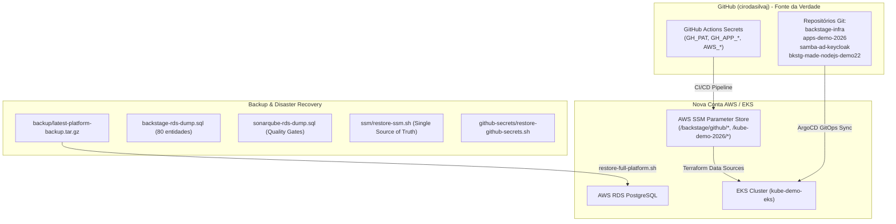

# Runbook de Recuperação de Desastre e Re-deploy Completo (Disaster Recovery)

> **Objetivo:** Procedimento passo a passo para recriar 100% da plataforma (EKS, Backstage, SonarQube, Grafana, ArgoCD, microserviços e integrações com o GitHub) em uma nova conta AWS a partir do zero ou restaurar backups após descarte de conta temporária DEMO.
> **Última Atualização:** 02/11/2026
> **Responsável:** Engenharia de Plataforma Cloud / DevEx

---

## 1. Visão Geral da Arquitetura e Persistência

Toda a plataforma foi construída com o princípio de **Infraestrutura como Código Imutável (IaC)** e **GitOps**, onde nenhum dado ou configuração essencial reside apenas em containers efêmeros.



---

## 2. Estrutura do Pacote de Backup Gerado

O script automatizado [`scripts/backup-full-platform.sh`](file:///home/ciro/backstate-infra/scripts/backup-full-platform.sh) gera um arquivo compactado e testado contendo:

| Arquivo no Backup | Descrição |
| :--- | :--- |
| `backstage-rds-dump.sql` | Dump completo do banco Backstage no RDS (Knex migrations, entidades de catálogo, relacionamentos e Scaffolder tasks). |
| `sonarqube-rds-dump.sql` | Dump completo do banco SonarQube no RDS (regras, histórico de análises, Quality Gates e usuários). |
| `ssm/aws-ssm-parameters.json` | Dump JSON de todos os parâmetros do AWS Parameter Store. |
| `ssm/restore-ssm.sh` | Script autoexecutável para repovoar o Parameter Store em qualquer nova conta AWS via AWS CLI. |
| `github-secrets/restore-github-secrets.sh` | Script para repovoar os 7 segredos nos repositórios GitHub via GitHub CLI. |
| `github-secrets/*.private-key.pem` | Chave RSA privada do GitHub App `backstage-devex-cirodasilvaj-2026`. |
| `k8s/` | Manifestos ativos de todos os namespaces (`backstage`, `argocd`, `apps-demo`, `sonarqube`, `grafana`). |
| `BACKUP_METADATA.json` | Metadados do backup (contadores de registros, hashes e versões). |
| `SHA256SUMS` | Assinaturas de integridade criptográfica SHA256 de cada arquivo. |

---

## 3. Passo a Passo: Subida do Zero em Nova Conta AWS

Quando esta conta DEMO expirar e você receber uma nova conta AWS, basta seguir este roteiro de 3 passos:

### Passo 1: Configurar Credenciais da Nova Conta AWS

1. No terminal ou nos Secrets do GitHub Actions (`cirodasilvaj/backstage-infra` e `cirobessa/kube-demo-2026`):
   - Atualize `AWS_ACCESS_KEY_ID`, `AWS_SECRET_ACCESS_KEY`, `AWS_REGION` (`us-east-1`).
2. Se estiver rodando localmente via CLI:
   ```bash
   aws configure
   ```

### Passo 2: Executar o Provisionamento do EKS e da Infraestrutura

1. **Subir o Cluster EKS (`kube-demo-2026`):**
   * Pelo GitHub Actions: Dispare a action `eks` via `workflow_dispatch` (ou push).
   * Ou via terminal:
     ```bash
     cd /home/ciro/kube-demo-2026/eks
     terraform init
     terraform apply -auto-approve
     ```
2. **Subir a Plataforma Backstage + RDS + SonarQube + Grafana (`backstage-infra`):**
   * Pelo GitHub Actions: Dispare o workflow `terraform` no repositório `cirodasilvaj/backstage-infra`.
   * **O que acontece automaticamente:**
     - O workflow resgata os segredos `GH_APP_*` e cria os parâmetros no AWS SSM Parameter Store (`/backstage/github/*`).
     - Provisiona o RDS PostgreSQL na VPC do cluster.
     - Provisiona Backstage, SonarQube, Grafana e Fluentd via Terraform/Helm.
     - Cria o Secret `backstage-github-credentials` no Kubernetes.
     - O Backstage entra em execução (`3/3 Running`) com todas as permissões administrativas no GitHub prontas!

---

### Passo 3: Restaurar o Histórico dos Bancos de Dados (Opcional)

Se você desejar restaurar o catálogo anterior e histórico de execuções sem esperar a auto-descoberta inicial:

```bash
cd /home/ciro/backstate-infra
./scripts/restore-full-platform.sh backup/latest-platform-backup.tar.gz
```

O script restaura:
1. Todos os parâmetros no AWS Parameter Store.
2. Todos os segredos no GitHub Actions.
3. O banco de dados do Backstage e do SonarQube via container `backstage-db-sync`.
4. Reinicia os pods e valida as rotas de healthcheck e APIs.

---

## 4. Como Executar um Novo Backup a Qualquer Momento

Para capturar um novo snapshot completo com um comando:

```bash
/home/ciro/backstate-infra/scripts/backup-full-platform.sh
```

O backup será gravado em `backup/snapshots/<TIMESTAMP>` e compactado em `backup/full-platform-backup-<TIMESTAMP>.tar.gz` e `backup/latest-platform-backup.tar.gz`.
